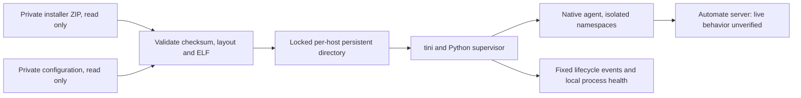

# Architecture

The release image contains a digest-pinned Ubuntu base, CA certificates, Python
standard library, tini and original wrapper code. It has no enrolled identity.
Only the explicitly selected `runtime` Dockerfile target is released. The `mock`
target compiles original test code and is never published.

The wrapper copies only four verified payload names from a ZIP after validating
every member. It never evaluates installer shell assignments or invokes vendor
installation/uninstallation scripts. Users provide configuration separately.

A local-filesystem `flock` lasts for the complete supervisor or maintenance
operation. A UUID ties the volume to an explicitly configured host instance;
this is a guard, not a distributed identity service. Shared/NFS volumes and
cloning a registered volume are unsupported. The host operator must keep UUIDs
distinct and must not start copied identities elsewhere.

Initialization and upgrades use private atomic file replacement plus a durable
transaction marker. An interrupted transaction refuses startup until a complete
snapshot is restored. Initialization never executes the agent. `run` launches
one agent under supervision; tini reaps orphaned descendants. The supervisor
forwards SIGTERM to the child group and escalates after its shutdown deadline.
The Compose deadline is longer to allow cleanup.

State metadata contains schema, identity, configuration hash and payload hashes,
never plaintext enrollment credentials. Runtime configuration is reasserted on
every start. Changes to the supplied config or installer require explicit
upgrade. A change of server or location is refused for an existing identity.

Health checks validate fresh supervisor status, child and supervisor PID start
times, running state, lock ownership and state access. A stopped/zombie process
is unhealthy. An agent stuck internally while still scheduled may remain
process-healthy; without a verified vendor acknowledgement, communication is
always `unknown`. Network loss does not automatically destroy identity or trigger
re-enrollment. Vendor reconnection behavior is not proven by the mock.
